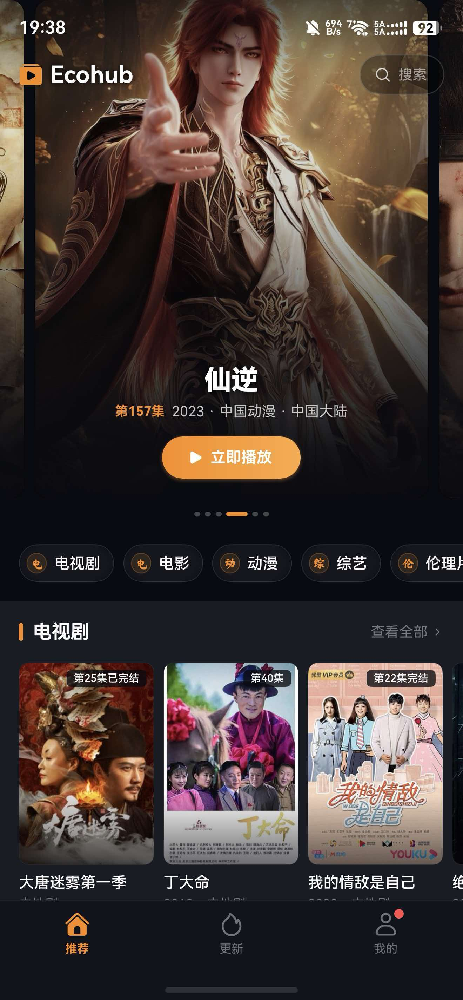

# EcoHub for OHOS

[](https://github.com/fe-spark/EcoHub-for-OHOS/releases)
[](https://github.com/fe-spark/EcoHub-for-OHOS/releases/latest)
[](https://www.openharmony.cn/)

[EcoHub](https://github.com/fe-spark/EcoHub) 的 OpenHarmony / HarmonyOS 原生客户端。

> **提示**：本仓库是 EcoHub 的纯客户端应用，**本身不提供、不存储任何影视资源**。安装后需要配置并接入 EcoHub 软件源（服务端）方可正常浏览与观影。
> 
> 相关项目：[EcoHub 主仓库（服务端 + Web）](https://github.com/fe-spark/EcoHub) · [EcoHub for Android](https://github.com/fe-spark/EcoHub-for-Android)

<div align="center">



</div>

---

## 📥 下载安装

- 🚀 **[下载最新版本 HAP (Releases Latest)](https://github.com/fe-spark/EcoHub-for-OHOS/releases/latest)**
- 📜 **[查看所有历史版本与更新日志](https://github.com/fe-spark/EcoHub-for-OHOS/releases)**

---

## 📡 软件源说明

客户端所有影视列表、分类、搜索、播放地址均由 **EcoHub 软件源** 提供。

### 1. 软件源怎么来？

- **自建部署（推荐）**  
  按照 [EcoHub 部署指南](https://github.com/fe-spark/EcoHub/blob/main/docs/README-Deploy.md) 在你的服务器上部署 EcoHub 服务端。  
  部署成功后，在管理后台「工作台」点击「订阅地址」即可获取客户端订阅源：
  ```
  http://<你的服务器IP或域名>:3000/api/provide/app
  ```
  *(若配置了 HTTPS 或反向代理，格式为 `https://<你的域名>/api/provide/app`，亦兼容原 `/api` 路径)*。在管理后台完成影视数据采集后，客户端即可直接同步。

- **使用公共源 / 他人分享源**  
  如果你有朋友已经部署了 EcoHub 站点，或使用社区公开的 EcoHub 节点，可以直接获取其软件源地址填入（例如官方演示源 `https://eco.fe-spark.cn/api/provide/app`）。

### 2. 如何在 App 中配置？

1. 打开 App，首次进入或未连接时会自动弹出 **软件源配置** 界面；
2. 输入软件源地址（如 `http://<服务器IP或域名>:3000` 或复制后台完整的 `/api/provide/app` 订阅源，未填协议头会自动补齐 `https://`；若站点开启了私有化访问，在地址末尾追加 `?key=您的密钥`）；
3. 点击 **开始观影** / **重新接入**，App 会自动测试与服务端的连通性（请求 `/api/provide/app` 接口）；
4. 校验通过后即可进入首页观影。后续可在「我的」或设置中管理/切换历史软件源。

---

## 推荐

### 服务器

| 服务商 | 说明 | 链接 |
| --- | --- | --- |
| CloudCone | 1. 演示站点所用服务商<br>2. 高性价比 VPS，磁盘 I/O 不受限 | [前往选购](https://app.cloudcone.com/?ref=14393) |

### 网络服务

| 服务商 | 特点 / 价格 | 链接 |
| --- | --- | --- |
| 良心云 | 低至 2 元/月 <br>新用户注册即获体验流量 | [前往注册](https://xn--9kqz23b19z.com/#/register?code=xAmvfdic) |
| 赔钱机场 | 低至 1.5 元/月 <br>适合高流量与备用需求 | [前往注册](https://xn--mes358aby2apfg.com/register?code=FA4xlzHD&cover=sfw) |
| DOVE | 适合长期稳定 | [前往注册](https://dovee.cc/a.php?asbcbO1PCgTx2JM66) |

---
## 💡 开发避坑指南（屏幕旋转与渲染性能最佳实践）

### 🚨 典型问题：手机旋转卡出系统桌面壁纸、延迟后才变全屏

#### 1. 现象描述
在控制中心关闭系统旋转锁定后，手机在应用内进行横竖屏旋转时，应用画面被卡在旧尺寸的正方形区域（如 `727×727`），其余未铺满区域直接**卡出系统底层的桌面壁纸**，持续约 300~500ms 后才突然展开为全屏。
> **特征**：数据加载中（仅 Loading 指示器）时旋转完全正常顺滑，一旦影视列表加载完成并渲染海报后，旋转必定卡出桌面背景。

#### 2. 深层原因剖析（四大连环瓶颈）
1. **`AppStorage` 广播风暴引发子组件级联 Re-render 堵死 UI 线程**：
   - 推荐页包含 12 组 `FilmRow`，原先每个 `FilmRow` 内部都直接声明了 4 个 `@StorageLink`（`WINDOW_WIDTH`、`WIDTH_BP`、`SAFE_INSET_LEFT`、`SAFE_INSET_RIGHT`）。
   - 旋转瞬间窗口发生改变，触发系统向 `AppStorage` 广播。单个旋转动作瞬间引爆 $12 \times 4 = 48$ 次组件级重绘，联动底层成百上千张 `FilmCard` 在同一个 VSync 帧周期内疯狂重复测量与排版（CPU 打满超 800ms）。
   - 渲染线程严重超载掉帧，无法在垂直同步周期内向窗口管理器（WMS）提交新方向的画面 Buffer，触发系统转场超时兜底，直接露出了底层的桌面壁纸。
2. **规避区监听密集触发无防抖的跨进程同步 IPC**：
   - 屏幕旋转阶段系统会连续发送 3~4 次 `onAvoidAreaChange` 和 `windowSizeChange` 事件。
   - 原逻辑在每次回调中均**无条件同步调用 4 次系统 IPC**（`win.getWindowAvoidArea()`，分别同步查询状态栏、刘海屏、导航条、软键盘）。
   - 在旋转转场的几十毫秒关键过渡期内发起数十次跨进程同步阻塞，使主线程雪上加霜。
3. **`XComponent (SURFACE)` 挖洞图层与动态异步宽高计算失步**：
   - 播放器采用 `XComponentType.SURFACE` 原生渲染模式。在鸿蒙渲染架构中，Surface 属于独立物理图层，通过向上“穿透挖洞（Punch-Hole）”展示在窗口中。
   - 原实现试图在 `VideoPlayer` 中通过异步 `onAreaChange` 回调计算宽高，再作为 `@Prop` 传递给 `PlayerVideoLayer` 动态算出百分比。
   - 旋转发生瞬间，ArkUI 窗口与容器已被 WMS 强制拉伸，但 `onAreaChange` 事件存在多帧延迟，导致 XComponent 被赋予了过期的旧尺寸或 0 尺寸，原生视频帧与 ArkUI 挖洞区域严重失调断层，缝隙直接穿透露出系统桌面。
4. **旋转朝向竞态仲裁导致“两阶段回弹抖动（Jitter）”**：
   - 过去全屏逻辑根据即时物理窗口宽高判断（`rect.width > rect.height`），并采用 `USER_ROTATION_*`。
   - 在手机快速翻转时，由于重力感应器与应用旋转指令处于竞争状态，应用常在临界点误判当前朝向，导致系统窗口经历 **“横屏 $\to$ 竖屏回跳 $\to$ 重新横屏”** 的二次销毁重建，画面撕裂穿透。

#### 3. 核心规范与防错准则

##### (1) 状态流转与全局存储治理
- ✅ **严禁在可复用列表子组件内部滥用 `@StorageLink`**：
  - 必须由父容器页面（如 `RecommendTab`）统一订阅窗口断点与边距，再通过基础 `@Prop` 传给子组件 `FilmRow`。
  - 切断全局状态向下广播的级联 Re-render 风暴，将旋转期间的测量排版耗时从 800ms+ 压缩至 16ms 极速水准。
- ✅ **规避区与尺寸回调必须严格做内存值缓存（防抖去重）**：
  - 在 `WindowBar.notifyInsets` 中对 `top/bottom/left/right` 及软键盘高度做历史值比对；只有真实像素值变动时才调用 `AppStorage.setOrCreate`，过滤 95% 无效 IPC 与事件派发。

##### (2) XComponent 原生渲染层规范
- ✅ **抛弃基于 `onAreaChange` 的动态百分比推算**：
  - 使用 ArkUI 原生声明式规则自适应：
    - **横屏视频**（16:9）：锁定宽度为 `100%`，高度设为 `undefined`，由 `aspectRatio` 自动匹配计算；
    - **竖屏视频**（9:16 短剧）：锁定高度为 `100%`，宽度设为 `undefined`，避免被容器强行撑高撑爆详情页；
    - 增加 `.constraintSize({ maxWidth: '100%', maxHeight: '100%' })` 兜底保护。
- ✅ **播放器外层容器必须增加 `.clip(true)` 强行裁切保护**，彻底杜绝视频 Surface 溢出或比例拉伸。

##### (3) 全屏与转场锁定
- ✅ **全屏进入即锁死目标朝向**：
  - 横屏视频点击全屏直接锁定 `window.Orientation.LANDSCAPE`，杜绝一切由于手机旋转引起的窗口反复拉扯；
  - 退出全屏后恢复系统自动旋转策略 `AUTO_ROTATION_RESTRICTED`，随重力感应自然回落。

##### (4) 基础排版禁忌
- ❌ **禁止在任何页面根容器上使用 `.renderGroup(true)` 和根级 `.clip(true)`**（避免转场期间复用未更新的离屏纹理产生黑洞）。
- ❌ **禁止在列表卡片根节点上挂载全局 `.animation()`**。按压缩放等局部交互动效必须在 `onTouch` 中使用 `this.getUIContext().animateTo` 显式驱动。
- ❌ **避免在滚动列表项中滥用实时毛玻璃 `.backdropBlur`**，尽量使用半透明纯色背景替代。
- ✅ **保持底层纯色兜底**：在 `WindowBar.applyBarColors()` 中始终保证 `target.setWindowBackgroundColor(AppTheme.BG)`，确保窗口层与页面底色始终一致。
---

## 🛠️ 本地开发

使用 [DevEco Studio](https://developer.huawei.com/consumer/cn/deveco-studio/) 打开本工程目录进行调试与打包构建。

---

## 📄 开源许可

本项目遵循 [PolyForm Noncommercial 1.0.0](https://github.com/fe-spark/EcoHub/blob/main/LICENSE) 协议。
